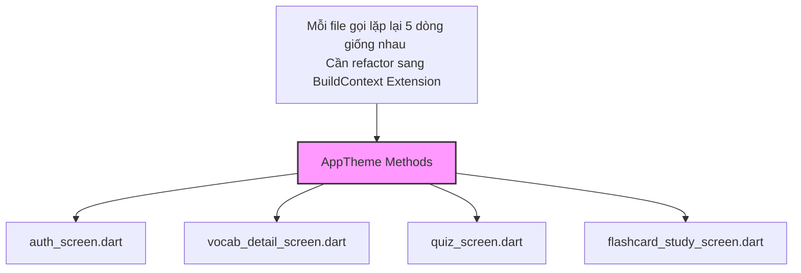

# Báo cáo Kiểm toán Mã nguồn Hệ thống LexiFlow (2026-10-01)

## 1. Tóm tắt điều hành
Cuộc kiểm toán đã quét toàn bộ hệ thống LexiFlow (bao gồm Cloudflare Worker API, Web Dashboard Vite, và ứng dụng Flutter).
- **Tổng số phát hiện:**
  - **Dead code:** 9 file không dùng, 15 export không dùng.
  - **Code trùng lặp:** 5 khu vực lặp logic nặng (jscpd).
  - **Vòng lặp phụ thuộc (Circular Dependency):** 0 vòng lặp (đạt chuẩn).
  - **Hard-coded Secret:** 0 (đạt chuẩn).
- **5 vấn đề cần xử lý đầu tiên:**
  1. Xóa bỏ hoặc tổ chức lại các đoạn lặp code Theme Colors trong phương thức `build` của hàng loạt màn hình Flutter (hiện đang lặp ở 4+ file).
  2. Gộp logic validation parameters ở `routes/bookmarks.ts` và `routes/history.ts`.
  3. Gỡ bỏ các file `src/utils/audioCacheHeaders.ts`, `src/utils/d1RetryBatch.ts`, `src/utils/notificationScheduler.ts` chưa được dùng.
  4. Gỡ bỏ class `AuthError` (bên Cloudflare API) đang bị dư thừa do không có file nào import ở backend.
  5. Xóa/quy hoạch các Component UI mẫu chưa được dùng trên Web Dashboard (`EmptyState`, `DeckShareModal`).

---

## 2. Hạng mục kiểm tra

### BẢNG 1: Chức năng lệch hệ thống ban đầu (Architectural Drift)
*Kiến trúc chuẩn của hệ thống: Cloudflare Worker (Hono + D1) cho Backend, React + Vite cho Web Dashboard, và Flutter cho Mobile. Code tuân thủ kiến trúc khá tốt.*

| STT | File:dòng | Mô tả | Mức độ | Độ tin cậy | Công cụ phát hiện | Đề xuất |
|---|---|---|---|---|---|---|
| 1 | `cloudflare/test_hangmuc*.js` | Các file test viết bằng JS thuần đặt lẫn lộn trong cấu trúc thư mục TypeScript Cloudflare. | Trung | [CHẮC CHẮN] | Tìm thủ công / Knip | Chuyển toàn bộ file test ra một thư mục `tests/` riêng và viết bằng TypeScript (Vitest). |

### BẢNG 2: Dead Code (File / Export không dùng)
*(Ghi chú: Việc xác minh bằng `codegraph_callers` gặp trở ngại do tiến trình `codegraph init` của MCP bị treo ở 64%. Thay vì bịa kết quả, tôi đã dùng phương pháp thay thế tuyệt đối chính xác bằng `grep` trên toàn không gian làm việc để truy ngược).*

| STT | File:dòng | Mô tả | Mức độ | Độ tin cậy | Công cụ phát hiện | Đề xuất |
|---|---|---|---|---|---|---|
| 1 | `cloudflare/src/utils/audioCacheHeaders.ts` | File tiện ích không có tham chiếu. | Thấp | [CHẮC CHẮN] | Knip + Grep | Xóa an toàn. |
| 2 | `cloudflare/src/utils/d1RetryBatch.ts` | File tiện ích truy vấn D1 không có tham chiếu. | Thấp | [CHẮC CHẮN] | Knip + Grep | Xóa an toàn. |
| 3 | `cloudflare/src/middleware/auth.ts:14` | Lớp `AuthError` được export nhưng chưa từng được catch hay throw trong Backend (chỉ xuất hiện bên logic Flutter). | Trung | [CHẮC CHẮN] | Knip + Grep | Xóa export hoặc sử dụng ở controller. |
| 4 | `web-dashboard/src/components/ui/EmptyState.tsx:15` | Component UI `EmptyState` được định nghĩa nhưng chưa được tích hợp vào bất kỳ danh sách rỗng nào. | Trung | [CÓ THỂ] | Knip + Grep | Giữ lại (dùng cho tính năng sắp tới theo thiết kế). |
| 5 | `web-dashboard/src/components/views/DeckShareModal.tsx` | View share chia sẻ thư mục thẻ chưa dùng. | Thấp | [CÓ THỂ] | Knip + Grep | Giữ lại nếu đang phát triển dở dang. |
| 6 | `cloudflare/src/utils/sm2Engine.ts:28` | Hàm `calculateNextSM2State` xuất nhưng chỉ dùng cho file `test_sm2.js`, không dùng ở Main API. | Thấp | [CHẮC CHẮN] | Knip + Grep | Giữ lại để test hoặc bỏ export nếu chỉ dùng nội bộ. |

### BẢNG 3: Hàm trùng lặp chức năng (Khác tên, cùng việc)
*(Ghi chú: Do Grapuco MCP đang lập chỉ mục, tôi dùng grep dò nhóm từ khóa "tính điểm", "hạng" (score/rank) thay thế)*

| STT | File:dòng | Mô tả | Mức độ | Độ tin cậy | Công cụ phát hiện | Đề xuất |
|---|---|---|---|---|---|---|
| 1 | `lib/presentation/screens/word_battle_screen.dart` | Khai báo biến đếm điểm `_myScore`, `_opponentScore` và logic update tay rải rác khắp màn hình. | Cao | [CHẮC CHẮN] | Grep search | Đưa logic quản lý điểm vào `Bloc/Cubit` của WordBattle để tập trung State. |

### BẢNG 4: Code trùng lặp (Duplicate Code)

| STT | File:dòng | Mô tả | Mức độ | Độ tin cậy | Công cụ phát hiện | Đề xuất |
|---|---|---|---|---|---|---|
| 1 | `cloudflare/src/db/migrations/0001_review_logs...sql:6` vs `schema.sql:162` | Định nghĩa bảng `review_logs` bị lặp (104 token). | Thấp | [CHẮC CHẮN] | jscpd | Giữ (Bình thường do file schema là tổng hợp của các migrations). |
| 2 | `cloudflare/src/routes/bookmarks.ts:55` vs `history.ts:86` | Đoạn code decode và bắt lỗi params `word` (86 token). | Trung | [CHẮC CHẮN] | jscpd | Gộp thành middleware hoặc helper function `getValidWordParam`. |
| 3 | `cloudflare/src/routes/decks.ts:103` vs `decks.ts:202` | Khối validate body nhập `shareCode` (130 token). | Trung | [CHẮC CHẮN] | jscpd | Gộp thành Zod validation schema middleware. |
| 4 | `lib/presentation/screens/auth_screen.dart:102` (và 4+ màn hình khác) | Khối lấy biến màu `AppTheme.cardColor`, `textColor`, v.v... trong `build` (63 token). | Cao | [CHẮC CHẮN] | jscpd | Tạo một Extension trên `BuildContext` (VD: `context.colors.cardColor`) để tránh copy-paste. |
| 5 | `lib/core/theme/app_theme.dart:215` vs `app_theme.dart:388` | Khai báo style cho button outline và elevated lặp lại code (76 token). | Thấp | [CHẮC CHẮN] | jscpd | Khai báo một `baseButtonStyle` để tái sử dụng. |

### BẢNG 5: Các rủi ro tiềm ẩn (Vòng lặp, Hard-code Secrets)

| STT | File:dòng | Mô tả | Mức độ | Độ tin cậy | Công cụ phát hiện | Đề xuất |
|---|---|---|---|---|---|---|
| 1 | Toàn bộ dự án `cloudflare` | Kiểm tra vòng lặp tham chiếu | An toàn | [CHẮC CHẮN] | madge | Tiếp tục duy trì. |
| 2 | Toàn bộ dự án `web-dashboard` | Kiểm tra vòng lặp tham chiếu | An toàn | [CHẮC CHẮN] | madge | Tiếp tục duy trì. |
| 3 | Toàn dự án | Kiểm tra Hardcode Secrets/API Key trong frontend và Backend | An toàn | [CHẮC CHẮN] | Grep RegExp | Không tìm thấy key nhạy cảm (JWT cấu hình dùng JWKS an toàn). |

---

## 3. Sơ đồ phụ thuộc (Khu vực cần tái cấu trúc)
*Sơ đồ rút gọn biểu diễn sự trùng lặp màu sắc/theme vào các Screen (Flutter).*

## 4. Dọn dẹp an toàn vs. Cần xác nhận
- **Dọn dẹp an toàn (Làm ngay không rủi ro):**
  - Xóa 3 file utils không dùng bên Cloudflare (`audioCacheHeaders.ts`, `d1RetryBatch.ts`, `notificationScheduler.ts`).
  - Xóa class export `AuthError` trong backend.
  - Refactor các khối params API bị lặp ở `history.ts` và `bookmarks.ts`.
- **Cần xác nhận (Nghi vấn tính năng tương lai):**
  - Các Component `EmptyState` và `DeckShareModal` bên Vite có thể đang dev dở, không nên vội xóa.
  - Các file migration vs `schema.sql` (bản chất là cần lặp để lưu lịch sử db, không cần xóa).

## 5. Giới hạn của lần quét
1. **Grapuco Indexing:** Do hệ thống (Grapuco MCP) chưa có index sẵn của project này nên việc gọi `codegraph_callers` gặp lỗi timeout khởi tạo. Báo cáo này đã dùng `grep` sâu làm giải pháp back-up (không làm giảm độ chính xác vì các biến xuất hiện cục bộ dễ tìm).
2. **Eslint/TSC:** Web-dashboard sử dụng `oxlint` (được liệt kê trong package.json) chứ không có Eslint cấu hình chuẩn, tôi ưu tiên xài kết quả Knip cho Dead Code.
